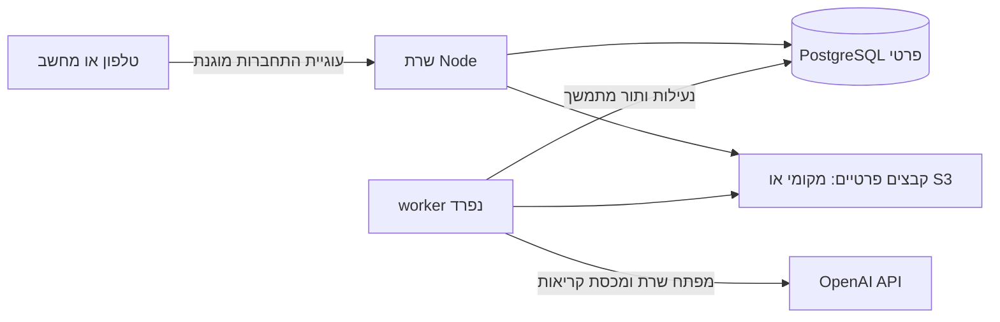

# מבנה והחלטות

יישום אישי לבעלים אחד: React/TypeScript בדפדפן, שרת Express/Node, PostgreSQL, תור עבודות במסד ו־worker נפרד. אותם מקורות קוד ניתנים להרצה במחשב, בשרת Docker או באירוח Node. אין תלות ב־Base44. לא נוסף מערך מיקרו־שירותים, Redis או שירות OCR נוסף בתשלום.

## בעלות וגישה

`kitchen.owner` מכיל מזהה קבוע אחד, עם אילוץ מסד המונע יצירת בעלים נוספים. אין מסלול הרשמה ציבורי ואין טבלאות Family, Invitations או Members. הסיסמה מגובבת באמצעות scrypt ומלח אקראי. אסימוני התחברות אקראיים נשמרים במסד רק כ־SHA-256; העוגייה היא HttpOnly/SameSite Strict, עם Secure בהפעלת HTTPS. בדיקת מקור חוסמת כתיבות מאתר אחר, ויש הגבלת קצב להתחברות ול־API.

כל נתיב נתונים, מדיה, ייבוא ו־AI נמצא אחרי בדיקת ההתחברות בשרת. אין גישה ישירה מהדפדפן למסד או ל־S3. `kitchen` הוא schema פרטי ש־PUBLIC אינו מורשה אליו; הוא אינו נחשף אוטומטית דרך Supabase Data API. ניתן להשתמש ב־PostgreSQL ייעודי או בחיבור שרת מאובטח ל־Supabase, אך לא הוחלה מיגרציה על פרויקט קיים של המשתמש.

ב־Compose מסד הנתונים אינו נחשף בפורט ציבורי. האתחול יוצר תפקיד יישום נפרד שאינו מנהל אשכול ואינו יכול ליצור מסדים או תפקידים. למנהל האתחול סיסמה אקראית אחרת, שאינה מועברת ל־API ול־worker. פורט היישום נקשר כברירת מחדל רק ל־127.0.0.1; לפריסה מרוחקת נדרש reverse proxy עם HTTPS, ולא חשיפה של תצורת הפיתוח לאינטרנט.

## נתונים

מתכונים, מצרכים, שלבים, שיוכי קטגוריות ומדיה נשמרים ברשומות נפרדות. גרסאות מתכון, מופעי בישול ומנות בארוחה שומרים snapshots עצמאיים; קובצי מדיה אינם מאוחסנים כ־base64 או בתוך ספר JSON ענק. עץ קטגוריות עם מיקום, שמות נרדפים ושיוכים מאושרים נשמר במסד. אין מיגרציה שממציאה אישור קטגוריות או יוצרת עץ בשם המשתמש.

חיפוש מחרוזות משתמש ב־GIN/pg_trgm התואם לשאילתות ILIKE; עימוד מתבצע בשרת. המיגרציה מתקינה את ההרחבה המהימנה במסד חדש, או משתמשת במיקום הקיים שלה אצל הספק. בחיבור מסד חיצוני נדרשת הרשאת התקנת pg_trgm או הפעלתה מראש בידי מנהל המסד.

רישומי `field_sources` מבחינים בין מקור, תיקון ידני, ברירת מחדל מפורשת והצעת AI. המקור נשמר בנפרד מהגרסה המחושבת. `revision` מגן על שמירת מתכונים, טיוטות ייבוא, בישולים, ארוחות ותוכניות מפני דריסה של גרסה קודמת; תגובת 409 מחייבת טעינה ובדיקה מחדש.

רשימות קניות נוצרות משמות, יחידות וחלופות נבחרות. המרות מסה ונפח מתמטיות, והמרות כוס או אריזה משתמשות רק בהגדרה מפורשת, עם עדיפות להגדרה במתכון על פני העדפה כללית. עדכון תפריט מציג את הקיים והמוצע ובוחר שורות להסרה/הוספה במפורש, במקום לדרוס עריכות וסימונים.

## תור והתאוששות

`jobs` עם `FOR UPDATE SKIP LOCKED`, lease, heartbeat, מפתח מניעת כפילות וגבול ניסיונות. worker אחר יכול לחדש פעולה מקומית אידמפוטנטית אחרי פקיעת lease. שליחת AI מסומנת לפני פנייה לספק, תחת נעילה ובדיקת מכסה; תקלה לאחר שליחה עוברת ל־uncertain ודורשת אישור מודע לניסיון חיוב נוסף. לא מובטח exactly-once מול ספק שאינו מספק זאת.

חילוץ נשמר לפני בקשת סיווג משנית. סריקה נוספת שומרת מועמד להשוואה; היא אינה מחליפה טיוטה או תיקון ידני. generation נפרד מ־revision מונע מעבודת סריקה ישנה להחיות פריט שאוחד או הוחלף. תמונת קטגוריה נוצרת פעם אחת למזהה ולגרסת בקשה, לא בכל שינוי שם. בחירה ידנית מוגנת מפני תוצאה מאוחרת של AI.

## מדיה

המקור נשמר ללא שינוי. Sharp יוצר thumbnail, תצוגה וגרסה קריאה אחרי סיבוב לפי EXIF; ניתן לפתוח את המקור המלא בזום. סרטון עובר בפועל FFmpeg ל־H.264/AAC עם faststart ו־poster, נטען במגע עם `preload=none` וניתן לבקשת Range. תמונה: עד 25MB; סרטון: עד 150MB/30 דקות; הקלטה: עד 20MB/10 דקות. גודל תמונה מוגבל גם במספר פיקסלים.

crop יוצר קובץ חדש וקישור להורה. גם חיתוך מתמונת AI נשאר מסומן כהמחשה, והחלפת תמונה אינה מוחקת את הקודמת. אין מחיקה אוטומטית של מדיה, כדי לא לפגוע בגרסאות, ארוחות, בישולים או היסטוריית תמונות. ניקוי אחסון עתידי חייב לספור את כל ההפניות.

## מעבר ספק ואחסון

שכבות AI ואחסון נפרדות. `STORAGE_DRIVER=local` מתאים להפעלה בשרת אחד עם volume משותף ל־API ול־worker. `STORAGE_DRIVER=s3` מתאים לדלי פרטי תואם S3; המדיה מוגשת דרך השרת המאומת. מיגרציות SQL ו־DATABASE_URL מחליפים ספק מסד בלי תלות בממשק ייעודי. הגיבוי כולל רשומות, הפניות, המקורות והנגזרות, עם בדיקת SHA-256 לפני שחזור.
